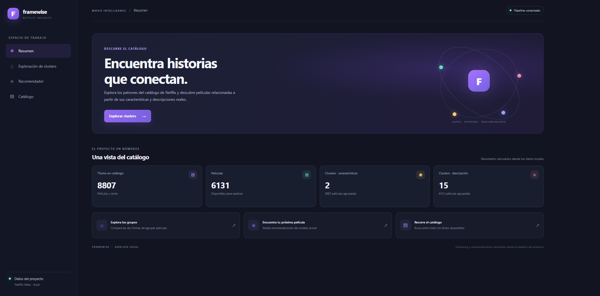

# Netflix Movie Insights

An interactive application for exploring a Netflix movie catalog, analyzing cluster distributions, and discovering similar movies through content-based recommendations. The project also includes reproducible experiments to evaluate clustering quality and compare different data representations.



## Table of Contents

- [Features](#features)
- [Data and Representations](#data-and-representations)
- [Results and Findings](#results-and-findings)
- [Requirements and Installation](#requirements-and-installation)
- [Running the Web Application](#running-the-web-application)
- [Running the Command-Line Application](#running-the-command-line-application)
- [Reproducing the Analysis](#reproducing-the-analysis)
- [Tests and Quality Checks](#tests-and-quality-checks)
- [Project Structure](#project-structure)
- [Publishing to GitHub](#publishing-to-github)
- [License and Dataset Usage](#license-and-dataset-usage)

## Features

The application provides a local web interface with four views:

- **Overview:** displays catalog statistics, the number of movies, and cluster counts for each representation.
- **Clusters:** explores cluster distributions and paginated movie listings based on structured features or textual descriptions.
- **Recommendation System:** select a movie, choose a representation, and specify the number of recommendations. Suggestions are retrieved from all eligible movies in the selected representation, regardless of cluster membership, and ranked by distance from the reference movie.
- **Movie Catalog:** search titles using case-insensitive partial matching, sort results, and browse the catalog with pagination. Movies can be selected to start a recommendation request.

The catalog is processed and the clusters are calculated when the application starts. These results are reused during the session, while recommendations are cached in memory. The application does not overwrite the source CSV or store user data.

## Data and Representations

The input catalog is stored in `data/netflix_titles.csv`. Both approaches use movie records only, but they may include different numbers of movies because each representation has its own data requirements.

### `char`: Structured Features

This representation uses release year, duration, rating, country, and genres.

Numerical variables are scaled, and categorical variables are encoded. Records with missing values in the required fields are removed.

The application uses KMeans with **2 clusters** to explore the distribution of movies based on structured metadata.

Recommendations use Euclidean distance across all eligible movies, independently of their cluster assignments.

### `desc`: Textual Descriptions

This representation uses movies with available descriptions. Each movie's title is concatenated with its description before generating a single TF-IDF vector.

This allows title terms to contribute to clustering and recommendations using the same preprocessing pipeline as the description text.

The TF-IDF pipeline in `src/peliculas/etl.py` applies the following configuration:

- `min_df=3` and `max_df=0.85` to filter terms based on document frequency.
- Unigrams and bigrams (`ngram_range=(1, 2)`).
- Sublinear term frequency (`sublinear_tf=True`).
- A maximum of **15 highest-weight TF-IDF terms per combined text**.
- Vector normalization after term selection.

The resulting TF-IDF matrix is sparse. The application uses KMeans with **15 clusters** and cosine distance to rank recommendations.

The feature matrix and cluster labels preserve the ordering of the same movie collection to prevent misalignment between titles and results.

Clusters are used to explore and summarize the catalog. They do not restrict the recommendation candidates: the recommender searches all movies with descriptions and ranks them by cosine distance.

## Results and Findings

The numerical results in this section come from the experiments documented in [`notebooks/plots.ipynb`](notebooks/plots.ipynb).

Silhouette comparisons use a fixed sample of 1,200 movies per representation. For `desc`, the historical baseline uses descriptions only, whereas the focused TF-IDF variant combines titles and descriptions.

Some silhouette scores are calculated in different feature spaces. Therefore, **scores from `char` and `desc` should not be compared directly**, nor should scores calculated in different representations be interpreted as equivalent measures of clustering quality.

### Structured Features (`char`)

- The reference KMeans model achieves an approximate silhouette score of **0.149** in the original feature space.
- The block-weighting experiment achieves a silhouette score of **0.500** in its weighted representation and **0.269** when evaluating the resulting labels in the original feature space.
- This improvement comes with a trade-off in cluster balance. The resulting clusters contain **701 and 4,986 movies**, compared with **1,859 and 3,828 movies** in the reference configuration.
- The balanced-block experiment and its improved labels are part of the notebook experiments. The application itself uses the standard feature-processing pipeline and standard KMeans configuration.

These results illustrate that feature weighting can change cluster separation, but a higher silhouette score in a modified representation does not automatically imply more useful or balanced movie groups.

### Textual Descriptions (`desc`)

- The baseline TF-IDF + KMeans model, using descriptions only, achieves an approximate silhouette score of **0.0071**. In the evaluation sample, **46.0%** of movies have negative silhouette values.
- The focused TF-IDF variant combines each movie's title and description, retains up to **15 highest-weight TF-IDF terms per combined text**, and produces a vocabulary of **7,979 terms**.
- Focused TF-IDF + NMF with 15 topics + KMeans achieves a silhouette score of **0.5371** in the topic space. When the resulting labels are evaluated in the reference TF-IDF space, the silhouette score is **0.0056**, with **37.5%** of movies having negative silhouette values, compared with **0.0071** and **46.0%** for the baseline.
- The NMF silhouette score is calculated in a different representation from the baseline score. It is therefore not directly comparable, and these results alone do not demonstrate better overall textual similarity.
- The clusters from the NMF experiment contain between **231 and 921 movies**, compared with **129 and 2,466 movies** in the baseline. The distribution is more balanced, although it remains uneven. Semantic quality still requires examining representative movies and terms.
- NMF converged after **130 iterations** in this experiment.
- **NMF is an experimental comparison in the notebook, not the algorithm used by the production application.** The application uses focused TF-IDF and standard KMeans for the description-based representation.

### Interpretation and Limitations

Internal clustering metrics are useful for comparing alternatives within the same representation, but they cannot establish whether recommendations are relevant to individual users.

The notebook includes cluster-size analysis, stability comparisons across random seeds, and functional recommendation tests. Reviewing representative movies and their associated terms is also important before interpreting clusters as definitive semantic categories.

The project is an exploratory recommendation system rather than a production-grade recommender trained on user ratings or interaction histories. Its recommendations are based on content similarity, not personalized user preferences.

## Requirements and Installation

The project requires:

- **Python 3.12 or later**.
- [uv](https://docs.astral.sh/uv/getting-started/installation/) for environment management and dependency synchronization.
- Git to clone the repository.

### 1. Clone the Repository

```bash
git clone https://github.com/dag3403/Movie-recommender.git
cd Movie-recommender
```

### 2. Install Dependencies

Install the application dependencies and development tools:

```bash
uv sync --locked --group dev
```

This command creates the `.venv` environment if necessary and synchronizes dependencies using the versions specified in `uv.lock`.

You do not need to activate the environment manually when running the commands in this guide with `uv run`.

## Running the Web Application

From the repository root, run:

```bash
uv run --locked peliculas-web
```

Open the application in your browser at:

<http://127.0.0.1:8000>

The initial startup may take some time because the application processes the catalog, builds the feature representations, and fits both KMeans models.

Stop the server with `Ctrl+C`.

To use a different address or port, run:

```bash
uv run --locked peliculas-web --host 127.0.0.1 --port 8001
```

The web application runs as a local development server. It is not configured for production deployment.

## Running the Command-Line Application

The project also provides an interactive command-line workflow:

```bash
uv run --locked peliculas
```

The program asks for a movie title, the number of recommendations, and the representation to use (`char` or `desc`).

For description-based recommendations, the selected movie must have a description and belong to the processed dataset.

## Reproducing the Analysis

Open `notebooks/plots.ipynb` in VS Code with the Jupyter extension or another compatible notebook environment.

Select the project's Python interpreter as the notebook kernel:

```text
.venv/bin/python
```

Then select **Run All** to execute the notebook from beginning to end.

The notebook searches for `data/netflix_titles.csv` in either `data/` or `../data/`, relative to the working directory, and recalculates the results. To reproduce the documented metrics, run all cells in order.

The notebook includes:

1. Analysis of baseline clustering quality and cluster-size distributions.
2. Experiments with alternative representations for `char` and `desc`.
3. Baseline comparisons and improvements using fixed samples, with metrics calculated within the corresponding representations.
4. Recommendation tests using ten reference movies and five recommendations per movie for each representation, including checks to exclude the reference movie and avoid duplicate recommendations.

The outputs saved in the notebook correspond to previous executions. To update them after changing the data or code, execute all cells and save the notebook.

## Tests and Quality Checks

### Run the Unit Tests

```bash
uv run --locked --group dev python -m unittest discover -s tests
```

### Check Code Style

```bash
uv run --locked --group dev ruff check src tests
```

### Build the Package

```bash
uv build
```

### Check Web Application Arguments

```bash
uv run --locked peliculas-web --help
```

These commands provide local checks for the project. The repository does not currently configure a continuous integration workflow.

## Project Structure

```text
.
├── data/
│   └── netflix_titles.csv   # Input movie catalog
├── docs/
│   └── images/
│       └── movie-explorer.png  # Application overview screenshot
├── notebooks/
│   └── plots.ipynb          # Analysis, evaluation, and recommendation experiments
├── src/peliculas/
│   ├── etl.py               # Data preparation, TF-IDF, clustering, and recommendations
│   ├── web.py               # Local HTTP server and application logic
│   ├── static/
│   │   ├── index.html       # Web interface
│   │   ├── app.js           # Frontend behavior
│   │   └── styles.css       # Interface styling
│   └── consts.py            # Paths and constants
├── tests/
│   ├── test_etl.py          # ETL and recommendation tests
│   └── test_web.py          # Web application logic tests
├── pyproject.toml           # Project metadata, dependencies, and commands
└── uv.lock                  # Locked dependency versions
```

## Publishing to GitHub

Before creating a commit, review the changes and check for whitespace errors:

```bash
git status --short
git diff --check
git diff --stat
```

Run the tests and quality checks described above.

Stage the files you intend to publish, create a commit, and push your branch. For example, if you are working on `main`:

```bash
git add README.md docs/images/movie-explorer.png
git commit -m "docs: improve project README and add application screenshot"
git push origin main
```

If you are working on a separate branch, replace `main` with your branch name. Open a pull request if you use a review-based workflow.

After pushing, visit the repository page and check that the README, screenshot, notebook, and project structure render correctly.

Do not commit virtual environments, generated build artifacts, cache directories, credentials, or private data.

## License and Dataset Usage

The repository does not currently declare a software license. Before allowing others to reuse or redistribute the code, choose an appropriate license and add a corresponding `LICENSE` file.

The dataset is included in `data/netflix_titles.csv`. Before distributing the repository publicly, verify and document the dataset's origin and whether its terms permit redistribution.

A license applied to the project code does not automatically grant rights to redistribute the dataset.